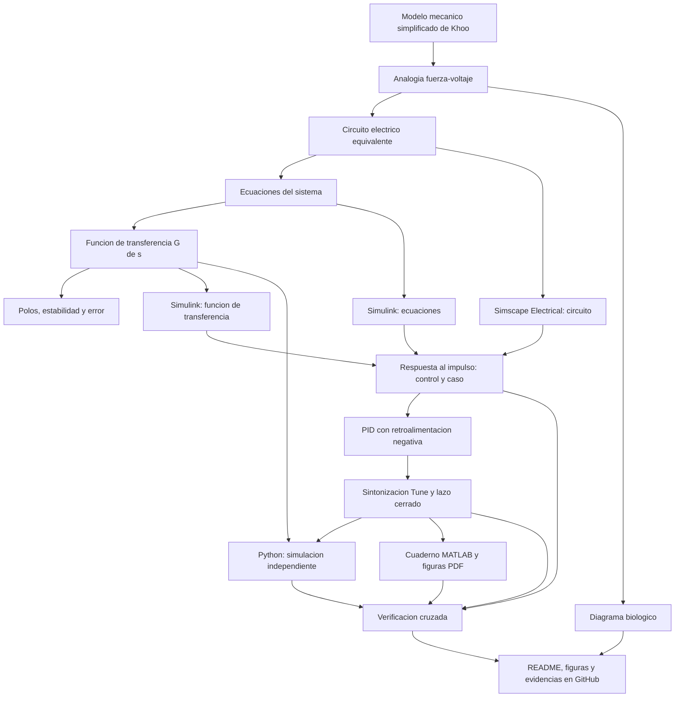

[REDAME.md](https://github.com/user-attachments/files/34348584/REDAME.md)
<!-- BOTÓN DE MATLAB ONLINE: reemplazar USUARIO por tu usuario de GitHub (el nombre del repositorio debe ser MSFP3). -->
[](https://matlab.mathworks.com/open/github/v1?repo=USUARIO/MSFP3)

# Práctica 3 (MSFP3) — Modelado y control del sistema musculoesquelético

Repositorio académico de la asignatura **Modelado de Sistemas Fisiológicos**, correspondiente al programa de **Ingeniería Biomédica** del Tecnológico Nacional de México / Instituto Tecnológico de Tijuana. Esta práctica integra analogías electromecánicas, modelado matemático, funciones de transferencia, análisis de estabilidad, diseño de un controlador PID y simulación computacional de un modelo viscoelástico del músculo esquelético.

El caso de estudio representa un compartimento musculoesquelético mediante el modelo mecánico simplificado de Khoo, formado por un elemento contráctil activo, un amortiguador viscoso y dos elementos elásticos. Se construye su **circuito eléctrico equivalente** con la analogía fuerza–voltaje y se compara la respuesta de un **individuo sano (control)** con la de un **caso simulado de atrofia muscular (caso)**. Posteriormente se diseña un controlador PID *in silico* que reduce la diferencia entre ambas respuestas.

**Docente:** Dr. Paul Antonio Valle Trujillo  
**Correo:** paul.valle@tectijuana.edu.mx  
**Departamento:** Ingeniería Eléctrica y Electrónica  
**Institución:** Tecnológico Nacional de México / Instituto Tecnológico de Tijuana  
**Asignatura:** Modelado de Sistemas Fisiológicos  
**Programa:** Ingeniería Biomédica  
**Estudiante:** Gael Sebastian Andrade Arellano · Número de control · correo@tijuana.tecnm.mx

**Repositorio de la asignatura:** https://github.com/DrPaulValle/MSF-IBF1020  
**Sede:** Blvd. Alberto Limón Padilla s/n, Tijuana, C. P. 22454, B. C., México.

---

<a id="contenido"></a>
## Contenido

1. [Resumen](#resumen)
2. [Competencia y objetivos](#objetivos)
3. [Relación con el temario](#temario)
4. [Modelo mecánico y analogía eléctrica](#analogia)
5. [Formulación matemática](#modelo)
6. [Análisis temporal y de estabilidad](#analisis)
7. [Señales de entrada y condiciones de simulación](#senales)
8. [Implementación en MATLAB, Simulink y Simscape](#matlab)
9. [Control en lazo cerrado y sintonización PID](#pid)
10. [Reproducción en Python](#python)
11. [Diagrama biológico](#biologico)
12. [Resultados y verificación cruzada](#resultados)
13. [Flujo de trabajo](#flujo)
14. [Actividades del estudiante](#actividades)
15. [Estructura del repositorio](#estructura)
16. [Requisitos](#requisitos)
17. [Reproducibilidad y entregables](#reproducibilidad)
18. [Referencias](#referencias)

---

<a id="resumen"></a>
## Resumen

La práctica tiene como propósito **modelar, analizar, simular y controlar** un sistema fisiológico a partir de su analogía con un circuito eléctrico. El comportamiento mecánico del músculo se aproxima mediante una fuente de fuerza activa $F_0(t)=\alpha F(t)$, un amortiguador viscoso $R$ y dos elementos elásticos, uno en paralelo $C_p$ y otro en serie $C_s$. Mediante la analogía fuerza–voltaje se obtiene un circuito equivalente, sus ecuaciones de equilibrio y la función de transferencia entre la fuerza aplicada $F(s)$ y el desplazamiento $X(s)$.

Se calculan los polos, los ceros y el valor final de las respuestas del **control** ($R=100\,\Omega$) y del **caso** ($R=10\,\mathrm{k}\Omega$), de modo que el único parámetro modificado es la componente viscosa. Ambos modelos se implementan en MATLAB/Simulink (ecuaciones, función de transferencia y circuito en Simscape Electrical) y se comparan ante un impulso unitario en $t\in[0,10]\,\mathrm{s}$. La respuesta del individuo sano se utiliza como referencia para el caso, y un **controlador PID** sintonizado con la herramienta *Tune* de Simulink reduce el error $e(t)=x_{\mathrm{control}}(t)-x_{\mathrm{caso}}(t)$. Los resultados se reproducen con un cuaderno de MATLAB y con Python, y los elementos del modelo se relacionan con estructuras musculoesqueléticas mediante un diagrama biológico.

La práctica se desarrolla **exclusivamente mediante experimentación *in silico***. La estrategia de control tiene propósitos académicos y de simulación, y **no constituye una estrategia terapéutica** para el tratamiento de la atrofia muscular.

**Palabras clave:** sistema musculoesquelético; modelo viscoelástico; analogía fuerza–voltaje; atrofia muscular; función de transferencia; controlador PID; MATLAB; Simulink; Simscape Electrical; Python; simulación *in silico*.

[Volver al contenido](#contenido)

---

<a id="objetivos"></a>
## Competencia y objetivos

### Competencia a desarrollar

Modelizar sistemas fisiológicos mediante analogías entre sistemas físicos, ecuaciones diferenciales y funciones de transferencia para analizar su comportamiento dinámico, y diseñar estrategias de control mediante técnicas de control clásico. En esta práctica se analiza un modelo mecánico simplificado del sistema musculoesquelético, se construye su circuito eléctrico equivalente con la analogía fuerza–voltaje, se compara la respuesta de un individuo sano (control) con un caso simulado de atrofia muscular (caso) y se diseña una estrategia de control *in silico* orientada a reducir las diferencias entre ambas respuestas.

### Objetivo general

Modelar y controlar *in silico* el sistema musculoesquelético mediante su analogía eléctrica, su formulación matemática y su implementación en MATLAB, Simulink, Simscape Electrical y Python, comparando las respuestas del control, del caso y del caso con controlador ante una entrada impulso.

### Objetivos específicos

- Identificar los elementos $F_0(t)$, $F(t)$, $R$, $C_p$, $C_s$, $x(t)$ y $x_1(t)$ del modelo mecánico y sus restricciones.
- Convertir el modelo mecánico en un circuito eléctrico equivalente mediante la analogía fuerza–voltaje.
- Formular las ecuaciones del sistema y verificar que el modelo mecánico y el circuito describan la misma dinámica.
- Obtener la función de transferencia $G(s)=X(s)/F(s)$ del control y del caso.
- Determinar el error en estado estacionario y analizar el efecto de modificar $R$.
- Calcular los polos, representarlos en el plano complejo y determinar la estabilidad de ambos modelos.
- Simular el modelo con ecuaciones, función de transferencia y componentes de Simscape Electrical.
- Comparar la respuesta al impulso unitario del control y del caso en $t\in[0,10]\,\mathrm{s}$.
- Implementar un controlador PID con la respuesta del control como referencia y sintonizar $k_P$, $k_I$ y $k_D$.
- Reproducir las respuestas con un cuaderno de MATLAB y con Python.
- Elaborar un diagrama biológico que relacione el modelo con estructuras musculoesqueléticas.
- Documentar los resultados en un repositorio de GitHub.

[Volver al contenido](#contenido)

---

<a id="temario"></a>
## Relación con el temario

El instructivo de la práctica no enumera unidades temáticas; la relación siguiente se establece por contenido y es análoga a la de las prácticas previas de la asignatura **Modelado de Sistemas Fisiológicos (IBF-1020)**:

| Área | Contenidos aplicados |
|---|---|
| Sistemas de control retroalimentados | Diagrama de bloques con retroalimentación negativa, señal de error, respuesta ante un impulso y criterios de estabilidad |
| Modelado matemático | Analogía fuerza–voltaje, equilibrio de fuerzas, relaciones constitutivas, función de transferencia y análisis de polos |
| Controladores | Diseño del PID y sintonización de ganancias con la herramienta *Tune* |

El enfoque combina **Ingeniería de Control, Electrónica Analógica, Ciencias de la Computación, Biomecánica y Fisiología**.

[Volver al contenido](#contenido)

---

<a id="analogia"></a>
## Modelo mecánico y analogía eléctrica

### Modelo mecánico (Figura 5.3 del instructivo)

El modelo de Khoo representa un compartimento musculoesquelético con un elemento contráctil activo $F_0$ en paralelo con un amortiguador $R$; esta combinación está en serie con el resorte $C_s$ y, en conjunto, en paralelo con el resorte $C_p$. La fuerza total $F(t)$ se aplica en el extremo libre.

| Elemento | Función mecánica | Asociación biológica simplificada |
|---|---|---|
| $F_0(t)$ | Fuerza del elemento contráctil activo, $F_0(t)=\alpha F(t)$ con $0<\alpha<1$ | Elemento contráctil muscular |
| $F(t)$ | Fuerza transmitida por el sistema tras considerar sus propiedades mecánicas | Fuerza generada |
| $R$ | Amortiguación viscosa inherente al tejido | Comportamiento viscoso |
| $C_p$ | Elasticidad del elemento paralelo | Sarcolema y estructuras musculares pasivas |
| $C_s$ | Elasticidad del elemento en serie | Tendones |
| $x(t)$ | Desplazamiento total, común al resorte $C_p$ y a la rama restante | Desplazamiento |
| $x_1(t)$ | Desplazamiento del resorte $C_s$ | Deformación del elemento en serie |
| $x(t)-x_1(t)$ | Deformación del amortiguador | Deformación viscosa |

La velocidad relativa del amortiguador es $\dfrac{d}{dt}[x(t)-x_1(t)]$.

### Analogía fuerza–voltaje

| Sistema mecánico | Sistema eléctrico equivalente | Unidades |
|---|---|---|
| Fuerza $F(t)$ | Voltaje $V(t)$ | $\mathrm{N}\leftrightarrow\mathrm{V}$ |
| Velocidad $\dot x(t)$ | Corriente $I(t)$ | $\mathrm{m/s}\leftrightarrow\mathrm{A}$ |
| Desplazamiento $x(t)$ | Carga eléctrica $q(t)$ | $\mathrm{m}\leftrightarrow\mathrm{C}$ |
| Amortiguador | Resistencia $R$ | $\mathrm{N\cdot s/m}\leftrightarrow\Omega$ |
| Compliancia mecánica | Capacitancia $C$ | $\mathrm{m/N}\leftrightarrow\mathrm{F}$ |
| Masa | Inductancia $L$ | $\mathrm{kg}\leftrightarrow\mathrm{H}$ (no presente en este modelo) |

Las conexiones mecánicas y eléctricas no conservan la misma topología: los componentes mecánicos en paralelo (comparten desplazamiento) se convierten en elementos eléctricos en serie (comparten corriente), y los componentes mecánicos en serie (comparten fuerza) se convierten en elementos eléctricos en paralelo (comparten voltaje).

### Circuito eléctrico equivalente

Aplicando esas reglas:

- $C_p$ y la rama restante comparten el desplazamiento $x(t)$, por lo que en el circuito quedan **en serie** y sus voltajes suman $V(t)$.
- $C_s$ y el bloque contráctil–viscoso comparten la misma fuerza, por lo que quedan **en paralelo**.
- $F_0$ y $R$ comparten la deformación $x(t)-x_1(t)$, por lo que quedan **en serie**: una fuente de voltaje $\alpha V(t)$ en serie con el resistor $R$.

El circuito resulta: fuente $V(t)$ → $C_p$ en serie con la combinación en paralelo de $C_s$ y de la rama (fuente $\alpha V(t)$ + $R$). Esta topología se deduce del diagrama del instructivo y debe verificarse al construir el modelo en Simscape. La variable de salida es el desplazamiento, que en el circuito corresponde a la carga: $x(t)=C_p\,v_{C_p}(t)$.

### Parámetros del circuito equivalente

| Parámetro | Control | Caso |
|---|---:|---:|
| $F(t)$ | $1\,\mathrm{V}$ | $1\,\mathrm{V}$ |
| $\alpha$ | $0.25$ | $0.25$ |
| $C_s$ | $10\,\mu\mathrm{F}$ | $10\,\mu\mathrm{F}$ |
| $C_p$ | $100\,\mu\mathrm{F}$ | $100\,\mu\mathrm{F}$ |
| $R$ | $100\,\Omega$ | $10\,\mathrm{k}\Omega$ |

La diferencia entre el control y el caso se representa **únicamente mediante el incremento de $R$**, que modifica la componente viscosa del modelo y produce una respuesta mecánica distinta.

> **Alcance de la analogía:** los valores corresponden al circuito eléctrico equivalente empleado para la experimentación *in silico*. No constituyen mediciones de parámetros biomecánicos reales ni una conversión numérica directa entre unidades eléctricas y mecánicas sin especificar factores de escala.

[Volver al contenido](#contenido)

---

<a id="modelo"></a>
## Formulación matemática

### 1. Relaciones constitutivas y equilibrio de fuerzas

Sean $f_p$ la fuerza en $C_p$ y $f_s$ la fuerza en la rama en serie. Para los elementos del modelo:

$$
x(t)=C_p f_p(t),\qquad x_1(t)=C_s f_s(t),\qquad f_s(t)=F_0(t)+R\frac{d}{dt}\left[x(t)-x_1(t)\right],\qquad F_0(t)=\alpha F(t).
$$

El equilibrio mecánico exige $F(t)=f_p(t)+f_s(t)$, de modo que

$$
F(t)=\frac{x(t)}{C_p}+\frac{x_1(t)}{C_s},
$$

$$
\frac{x_1(t)}{C_s}=\alpha F(t)+R\left[\dot x(t)-\dot x_1(t)\right].
$$

En el circuito equivalente, con $q=x$, $q_1=x_1$ e $I=\dot x$, la primera ecuación es la ley de voltajes $V=v_{C_p}+v_{C_s}$ y la segunda expresa que el voltaje en $C_s$ es igual al de la rama formada por la fuente $\alpha V$ y el resistor $R$. Ambas representaciones describen la misma dinámica.

### 2. Función de transferencia

Con condiciones iniciales nulas, al aplicar la transformada de Laplace:

$$
F(s)=\frac{X(s)}{C_p}+\frac{X_1(s)}{C_s}\quad\Rightarrow\quad X_1(s)=C_s\left[F(s)-\frac{X(s)}{C_p}\right],
$$

$$
\frac{X_1(s)}{C_s}=\alpha F(s)+Rs\left[X(s)-X_1(s)\right].
$$

Sustituyendo $X_1(s)$ y despejando $X(s)$ se obtiene

$$
\boxed{G(s)=\frac{X(s)}{F(s)}=\frac{C_p\left(RC_s\,s+1-\alpha\right)}{R\left(C_p+C_s\right)s+1}.}
$$

Definiendo la constante de tiempo $\tau=R(C_p+C_s)$ y la capacitancia en serie $C_{eq}=\dfrac{C_pC_s}{C_p+C_s}$, la función puede escribirse como

$$
G(s)=C_{eq}+\frac{C_p(1-\alpha)-C_{eq}}{\tau s+1}.
$$

El denominador es de **primer grado**: aunque hay dos elementos elásticos, la fuente impone $V=v_{C_p}+v_{C_s}$, por lo que solo una de las cargas es independiente. Además, el numerador y el denominador tienen el mismo grado, de modo que $G(s)$ es **bipropia** (tiene transmisión directa).

Sustituyendo los parámetros ($C_p=100\,\mu\mathrm{F}$, $C_s=10\,\mu\mathrm{F}$, $\alpha=0.25$):

$$
G_{\mathrm{control}}(s)=\frac{10^{-7}s+7.5\times10^{-5}}{0.011\,s+1},\qquad
G_{\mathrm{caso}}(s)=\frac{10^{-5}s+7.5\times10^{-5}}{1.1\,s+1}.
$$

### 3. Representación en variables de estado

Definiendo el estado $w(t)=x(t)-C_{eq}F(t)$, el modelo queda

$$
\begin{aligned}
\dot w(t)&=-\frac{1}{\tau}\,w(t)+\frac{C_p(1-\alpha)-C_{eq}}{\tau}\,F(t),\\
x(t)&=w(t)+C_{eq}\,F(t),
\end{aligned}
$$

con $A=-1/\tau$, $B=\left[C_p(1-\alpha)-C_{eq}\right]/\tau$, $C=1$ y $D=C_{eq}$.

[Volver al contenido](#contenido)

---

<a id="analisis"></a>
## Análisis temporal y de estabilidad

### 1. Error en estado estacionario

Para una entrada escalón de amplitud $F_0=1\,\mathrm{V}$, $F(s)=F_0/s$. Como ambos modelos son estables, el teorema del valor final es aplicable:

$$
x(\infty)=\lim_{s\to0}sG(s)\frac{F_0}{s}=G(0)F_0=C_p(1-\alpha)F_0=75\,\mu\mathrm{C}.
$$

El resultado no depende de $R$, por lo que el control y el caso alcanzan el mismo valor final y

$$
\boxed{e_{ss}=\lim_{t\to\infty}\left[x_{\mathrm{control}}(t)-x_{\mathrm{caso}}(t)\right]=0.}
$$

El incremento de $R$ **no modifica el valor final**, solo la velocidad con la que se alcanza. La diferencia entre control y caso es, por tanto, un efecto transitorio.

### 2. Polos, ceros y estabilidad

El polo de $G(s)$ satisface $R(C_p+C_s)s+1=0$ y el cero, $RC_s\,s+1-\alpha=0$:

$$
\boxed{p=-\frac{1}{R(C_p+C_s)},\qquad z=-\frac{1-\alpha}{RC_s}.}
$$

| Modelo | $R$ | $\tau=R(C_p+C_s)$ | Polo $p$ (rad/s) | Cero $z$ (rad/s) |
|---|---:|---:|---:|---:|
| Control | $100\,\Omega$ | $11\,\mathrm{ms}$ | $-1000/11\approx-90.91$ | $-750$ |
| Caso | $10\,\mathrm{k}\Omega$ | $1.1\,\mathrm{s}$ | $-10/11\approx-0.909$ | $-7.5$ |

Ambos polos son reales y negativos, por lo que los dos modelos son **estables** y su respuesta es **no oscilatoria**. El incremento de $R$ multiplica por 100 la constante de tiempo: el polo del caso se acerca al origen y la respuesta se vuelve más lenta. Como referencia, el tiempo de establecimiento de la componente exponencial es del orden de $4\tau$: aproximadamente $44\,\mathrm{ms}$ para el control y $4.4\,\mathrm{s}$ para el caso, ambos dentro de la ventana de $10\,\mathrm{s}$.

### 3. Respuesta al impulso

De la descomposición de $G(s)$, la respuesta al impulso unitario es

$$
g(t)=C_{eq}\,\delta(t)+\frac{C_p(1-\alpha)-C_{eq}}{\tau}\,e^{-t/\tau},\qquad t\ge0,
$$

con $C_{eq}=100/11\,\mu\mathrm{F}\approx9.09\,\mu\mathrm{F}$ y $C_p(1-\alpha)-C_{eq}=725/11\,\mu\mathrm{F}\approx65.9\,\mu\mathrm{F}$. La amplitud de la parte exponencial es $\approx5.99\times10^{-3}$ para el control y $\approx5.99\times10^{-5}$ para el caso (en $\mathrm{C/(V\cdot s)}$).

La componente $C_{eq}\,\delta(t)$ proviene de la transmisión directa de $G(s)$ y no puede representarse numéricamente de forma exacta; cada herramienta puede tratarla de manera distinta cerca de $t=0$, lo cual debe considerarse en la verificación cruzada.

### 4. Predicción previa

Antes de simular, elaborar un **bosquejo cualitativo** de la respuesta al impulso del control y del caso a partir del orden, los polos, la estabilidad y el valor final, y compararlo con las simulaciones.

#### Ejemplo mínimo de verificación en MATLAB

```matlab
alpha = 0.25;
Cs = 10e-6;      % F
Cp = 100e-6;     % F
R_control = 100;     % ohm
R_caso    = 10e3;    % ohm

G = @(R) tf(Cp*[R*Cs, 1-alpha], [R*(Cp+Cs), 1]);
G_control = G(R_control);
G_caso    = G(R_caso);

polos_control = pole(G_control)
ceros_control = zero(G_control)
polos_caso    = pole(G_caso)
ceros_caso    = zero(G_caso)
dcgain(G_control)    % valor final ante escalon unitario
dcgain(G_caso)
```

Este código es ilustrativo; no sustituye los archivos y procedimientos solicitados en la práctica.

[Volver al contenido](#contenido)

---

<a id="senales"></a>
## Señales de entrada y condiciones de simulación

El intervalo de simulación es $0\le t\le10\,\mathrm{s}$. El instructivo no especifica el solver ni el paso máximo; deben **documentarse** los empleados en Simulink y en Python.

| Señal | Definición | Propósito |
|---|---|---|
| Impulso unitario | $F(t)=\delta(t)$ | Respuesta en lazo abierto y en lazo cerrado de control, caso y caso con PID |
| Escalón | $F(t)=1\,\mathrm{V}$, $t\ge0$ | Análisis analítico del estado estacionario |

El impulso se aplica a las tres representaciones (ecuaciones, función de transferencia y circuito) del control y del caso, y posteriormente a Python. El impulso ideal no es realizable, por lo que debe indicarse cómo se aproxima en cada plataforma y mantener la misma aproximación en todas para que la comparación sea válida.

[Volver al contenido](#contenido)

---

<a id="matlab"></a>
## Implementación en MATLAB, Simulink y Simscape

Para las condiciones **control** y **caso** se construyen tres representaciones equivalentes:

| Implementación | Descripción | Aspecto por verificar |
|---|---|---|
| Ecuaciones del sistema, Simulink | Bloques que implementan las ecuaciones de equilibrio o el modelo de estado | Consistencia con el equilibrio de fuerzas |
| Función de transferencia, Simulink | Bloque de planta con $G(s)$ de cada condición | Respuesta entrada–salida de primer orden |
| Circuito equivalente, Simscape Electrical | Fuente $V(t)$, fuente controlada $\alpha V(t)$, $R$, $C_s$ y $C_p$ | Concordancia con las representaciones matemáticas |

En el circuito de Simscape, el desplazamiento se obtiene a partir del voltaje en $C_p$ mediante $x(t)=C_p\,v_{C_p}(t)$ (equivalentemente, integrando la corriente de la rama de $C_p$).

Debe verificarse que las representaciones produzcan **respuestas consistentes para las mismas condiciones iniciales y parámetros**.

### Ejecución desde el cuaderno MATLAB

El cuaderno computacional ejecuta los modelos de Simulink y almacena en el *Workspace* las respuestas de:

1. **Control:** $x_{\mathrm{control}}(t)$.
2. **Caso en lazo abierto:** $x_{\mathrm{caso}}(t)$.
3. **Caso con controlador:** $x_{\mathrm{PID}}(t)$.

Además, se desarrolla una función que (a) represente gráficamente las respuestas, (b) identifique las variables y sus unidades, (c) compare control, caso y sistema controlado y (d) guarde las figuras en formato PDF.

[Volver al contenido](#contenido)

---

<a id="pid"></a>
## Control en lazo cerrado y sintonización PID

### 1. Esquema de control (Figura 5.4 del instructivo)

La respuesta del individuo sano se usa como referencia para el caso. El modelo del control produce $x_{\mathrm{control}}(t)$; el controlador PID actúa sobre una copia del modelo del caso ("paciente en tratamiento") y la retroalimentación es negativa. La señal de error es

$$
e(t)=x_{\mathrm{control}}(t)-x_{\mathrm{caso}}(t).
$$

La ley de control ideal es

$$
u(t)=k_Pe(t)+k_I\int_0^t e(\tau)\,d\tau+k_D\frac{de(t)}{dt},\qquad K(s)=k_P+\frac{k_I}{s}+k_Ds.
$$

Con la planta del caso $G_{\mathrm{caso}}(s)$ y retroalimentación negativa unitaria, la salida controlada es

$$
X_{\mathrm{PID}}(s)=T(s)\,X_{\mathrm{control}}(s),\qquad
T(s)=\frac{K(s)G_{\mathrm{caso}}(s)}{1+K(s)G_{\mathrm{caso}}(s)},\qquad
X_{\mathrm{control}}(s)=G_{\mathrm{control}}(s)F(s).
$$

Deben revisarse la configuración del bloque **PID Controller** y el filtrado de la acción derivativa. Como $G_{\mathrm{caso}}(s)$ es bipropia, el lazo cerrado puede generar **lazos algebraicos** en Simulink; conviene atender cualquier advertencia al respecto.

### 2. Sintonización

Utilizar la herramienta **Tune** del bloque `PID Controller` para determinar $k_P$, $k_I$ y $k_D$, buscando una **respuesta estable** y una **reducción del error** entre la salida del caso y la respuesta del control. El instructivo no fija valores numéricos de tiempo de establecimiento ni de sobreimpulso; el criterio debe justificarse con la evidencia (por ejemplo, la comparación de $x_{\mathrm{PID}}(t)$ con $x_{\mathrm{control}}(t)$ y la reducción del error respecto al caso en lazo abierto). Conservar la captura de la configuración de *Tune* y de los parámetros utilizados.

### 3. Análisis de la respuesta en lazo cerrado

Repetir la simulación ante el impulso y comparar $x_{\mathrm{control}}(t)$, $x_{\mathrm{caso}}(t)$ y $x_{\mathrm{PID}}(t)$. Analizar el efecto del controlador sobre la amplitud, la velocidad de respuesta, el amortiguamiento y la diferencia entre el caso y el control.

[Volver al contenido](#contenido)

---

<a id="python"></a>
## Reproducción en Python

El programa en Python, ejecutado mediante **Visual Studio Code**, comprueba los resultados con una segunda herramienta. Se deben identificar y explicar los apartados siguientes:

1. Definición del vector temporal en $[0,10]\,\mathrm{s}$.
2. Definición de los parámetros del control y del caso.
3. Definición de las funciones de transferencia $G_{\mathrm{control}}(s)$ y $G_{\mathrm{caso}}(s)$.
4. Cálculo de la respuesta al impulso en lazo abierto con las mismas condiciones de simulación que en MATLAB/Simulink.
5. Definición del controlador con $k_P$, $k_I$ y $k_D$ obtenidas con *Tune*.
6. Construcción del sistema del caso en lazo cerrado.
7. Simulación de la respuesta controlada.
8. Generación y almacenamiento de figuras.

Las dependencias deben verificarse directamente en los módulos importados por el archivo `.py`. Comparar las respuestas de Python con las de MATLAB/Simulink **bajo las mismas entradas, condiciones y parámetros**.

[Volver al contenido](#contenido)

---

<a id="biologico"></a>
## Diagrama biológico

Elaborar con **BioRender** (o una herramienta equivalente) un diagrama que relacione los elementos del modelo con las estructuras del sistema musculoesquelético. Debe identificar como mínimo los elementos de la tabla y relacionar cada uno con su representación en el modelo mecánico y con su equivalente eléctrico.

| Elemento biológico | Modelo mecánico | Equivalente eléctrico |
|---|---|---|
| Elemento contráctil muscular | Fuente de fuerza $F_0(t)=\alpha F(t)$ | Fuente de voltaje $\alpha V(t)$ |
| Estructuras elásticas musculares (sarcolema, estructuras pasivas) | Resorte paralelo $C_p$ | Capacitor $C_p$ |
| Tendón | Resorte en serie $C_s$ | Capacitor $C_s$ |
| Desplazamiento | $x(t)$, $x_1(t)$ | Carga $q(t)$ |
| Fuerza generada | $F(t)$ | Voltaje $V(t)$ |
| Comportamiento viscoso | Amortiguador $R$ | Resistor $R$ |
| Comportamiento elástico | $C_p$ y $C_s$ | Capacitores $C_p$ y $C_s$ |

La asociación de $C_p$ y $C_s$ con las estructuras biológicas es simplificada, según el instructivo.

### Diagrama elaborado


*Figura. Diagrama biológico elaborado en BioRender: relaciona el elemento contráctil muscular ($F_0$), las estructuras elásticas musculares ($C_p$), el tendón ($C_s$), la fuerza generada ($F(t)$), los desplazamientos ($x(t)$, $x(t)-x_1(t)$) y los elementos asociados con el comportamiento viscoso y elástico ($R$) con el modelo mecánico de la Figura 5.3. Se indican los casos control ($R=100\,\Omega$) y caso ($R=10\,\mathrm{k}\Omega$).*

La imagen se muestra en este README mediante la ruta relativa `Diagrama_biologico.png`; el archivo debe estar en la raíz del repositorio (o ajustarse la ruta si se coloca en una subcarpeta).

[Volver al contenido](#contenido)

---

<a id="resultados"></a>
## Resultados y verificación cruzada

Las respuestas deben permitir contrastar **control, caso en lazo abierto y caso con controlador**. El instructivo no establece una convención de colores; cada figura debe incluir leyenda, ejes con sus variables y unidades, y las curvas $x_{\mathrm{control}}(t)$, $x_{\mathrm{caso}}(t)$ y $x_{\mathrm{PID}}(t)$ claramente identificadas.

### Archivos de resultados

Los nombres siguientes son **propuestas organizativas**, ya que el instructivo no los especifica.

| Comparación | MATLAB/Simulink | Python |
|---|---|---|
| Lazo abierto: control y caso | [`impulso_abierto_matlab.pdf`](impulso_abierto_matlab.pdf) | [`impulso_abierto_python.pdf`](impulso_abierto_python.pdf) |
| Lazo cerrado: control, caso y PID | [`impulso_cerrado_matlab.pdf`](impulso_cerrado_matlab.pdf) | [`impulso_cerrado_python.pdf`](impulso_cerrado_python.pdf) |

Los enlaces funcionan cuando los archivos están en la raíz del repositorio; si se organizan por carpetas, deben ajustarse las rutas relativas. Los PDF se enlazan para su consulta, dado que GitHub no los presenta como imágenes incrustadas convencionales.

### Verificación cruzada

Comparar las respuestas obtenidas con:

- las ecuaciones del sistema implementadas en Simulink;
- las funciones de transferencia en Simulink;
- el circuito eléctrico equivalente en Simscape Electrical;
- el cuaderno computacional de MATLAB; y
- el código desarrollado en Python.

Verificar que las implementaciones describan consistentemente la dinámica del sistema e identificar las posibles causas de cualquier diferencia (método numérico, tratamiento del impulso, discretización, implementación de los modelos).

### Aspectos para discutir

- Efecto del incremento de $R$ sobre el polo, la constante de tiempo y la forma de la respuesta.
- Coincidencia entre las representaciones por ecuaciones, función de transferencia y circuito.
- Efecto del PID sobre la amplitud, la velocidad de respuesta, el amortiguamiento y el error respecto al control.
- Consistencia entre las figuras de MATLAB y Python.
- Limitaciones del modelo y de la analogía, y alcance exclusivamente académico de la estrategia de control.

### Resultados del estudiante

| Controlador | $k_P$ | $k_I$ | $k_D$ |
|---|---|---|---|
| PID del caso | por completar | por completar | por completar |

Agregar en la versión final las ganancias sintonizadas, la captura de la configuración de *Tune*, las capturas de las simulaciones y un comentario interpretativo propio sobre cada familia de respuestas. No se incluyen ganancias ni resultados ficticios en esta plantilla.

[Volver al contenido](#contenido)

---

<a id="flujo"></a>
## Flujo de trabajo



El procedimiento integra la formulación analítica y la experimentación *in silico*; la práctica no incluye montaje de laboratorio.

[Volver al contenido](#contenido)

---

<a id="actividades"></a>
## Actividades del estudiante

La práctica sigue una secuencia de **modelado, simulación, control y documentación**.

### Etapa 1. Modelo, analogía y formulación

- [ ] Identificar $F_0(t)$, $F(t)$, $R$, $C_p$, $C_s$, $x(t)$ y $x_1(t)$ y describir su función mecánica.
- [ ] Construir el circuito eléctrico equivalente con la analogía fuerza–voltaje.
- [ ] Formular las ecuaciones del sistema y verificar su equivalencia con el circuito.
- [ ] Obtener $G(s)=X(s)/F(s)$ para el control y para el caso.
- [ ] Calcular el error en estado estacionario y analizar el efecto de $R$.
- [ ] Calcular los polos, representarlos en el plano complejo y determinar la estabilidad.

### Etapa 2. Simulación en lazo abierto

- [ ] Implementar el modelo por ecuaciones en Simulink (control y caso).
- [ ] Implementar la función de transferencia en Simulink (control y caso).
- [ ] Implementar el circuito equivalente en Simscape Electrical (control y caso).
- [ ] Obtener la respuesta al impulso unitario en $t\in[0,10]\,\mathrm{s}$ y comparar control y caso.

### Etapa 3. Control

- [ ] Construir el sistema de retroalimentación de la Figura 5.4 con el bloque PID Controller en el caso.
- [ ] Sintonizar y registrar $k_P$, $k_I$ y $k_D$, conservando la evidencia de *Tune*.
- [ ] Repetir la simulación en lazo cerrado y comparar $x_{\mathrm{control}}$, $x_{\mathrm{caso}}$ y $x_{\mathrm{PID}}$.

### Etapa 4. Verificación y documentación

- [ ] Desarrollar el cuaderno de MATLAB y la función que grafica y guarda las figuras en PDF.
- [ ] Implementar en Python las funciones de transferencia y el sistema en lazo cerrado.
- [ ] Realizar la verificación cruzada de las cinco implementaciones.
- [ ] Elaborar el diagrama biológico con BioRender o equivalente.
- [ ] Redactar la discusión y las conclusiones.
- [ ] Publicar los archivos y un `CITATION.cff` correctamente identificados.

[Volver al contenido](#contenido)

---

<a id="estructura"></a>
## Estructura del repositorio

Una organización **sugerida** para la entrega, compatible con los elementos solicitados, es:

```text
.
├── README.md                          # Reporte y guía de reproducción
├── CITATION.cff                       # Datos de citación del alumno y del repositorio
├── Apellido_NoControl.mlx             # Cuaderno MATLAB del estudiante
├── Apellido_NoControl.pdf             # Exportación del cuaderno
├── modelo_musculoesqueletico.slx      # Modelo Simulink (ecuaciones y función de transferencia)
├── circuito_simscape.slx              # Circuito equivalente en Simscape Electrical
├── modelo_musculoesqueletico.py       # Implementación Python
├── impulso_abierto_matlab.pdf
├── impulso_cerrado_matlab.pdf
├── impulso_abierto_python.pdf
├── impulso_cerrado_python.pdf
├── Diagrama_biologico.png             # Diagrama de BioRender (incrustado en el README)
├── capturas/                          # Capturas de simulaciones y de Tune
└── complementarios/                   # Archivos adicionales usados en la práctica
```

**Criterio de nombres:** los nombres de archivos son **propuestas organizativas**, ya que el instructivo solo especifica el contenido solicitado. Si se utilizan otros nombres o subcarpetas, actualizar las rutas del README y no eliminar evidencias requeridas.

[Volver al contenido](#contenido)

---

<a id="requisitos"></a>
## Requisitos

### Software

- **MATLAB** y **Simulink**, para los modelos y el cuaderno computacional.
- **Simscape Electrical**, para construir el circuito eléctrico equivalente.
- Herramientas de Simulink para el diseño y la sintonización del bloque **PID Controller** (*Tune*).
- **Control System Toolbox**, para las funciones `tf`, `pole` y `zero` del ejemplo de esta guía.
- **Python** y **Visual Studio Code**, para ejecutar la implementación de verificación.
- Las bibliotecas Python que importe efectivamente el código desarrollado.
- **BioRender** o herramienta equivalente, para el diagrama biológico.
- **Git y GitHub**, para organizar y presentar el repositorio.

Las versiones mínimas del software no se especifican en el instructivo.

### Recursos de laboratorio

No se requieren: la práctica se desarrolla exclusivamente mediante experimentación *in silico*.

[Volver al contenido](#contenido)

---

<a id="reproducibilidad"></a>
## Reproducibilidad y entregables

### Secuencia de reproducción

1. Consultar el [repositorio general de la asignatura](https://github.com/DrPaulValle/MSF-IBF1020) y descargar los archivos proporcionados para la práctica.
2. Analizar el modelo mecánico y construir el circuito equivalente con la analogía fuerza–voltaje.
3. Derivar las ecuaciones y las funciones de transferencia del control y del caso.
4. Calcular polos, estabilidad y error en estado estacionario.
5. Ejecutar los modelos de Simulink y Simscape con el impulso unitario.
6. Construir el sistema de control, sintonizar el PID y registrar las ganancias.
7. Ejecutar el cuaderno MATLAB y exportar las figuras en PDF.
8. Sustituir las ganancias en Python, reproducir las respuestas y exportar las figuras.
9. Realizar la verificación cruzada y elaborar el diagrama biológico.
10. Completar este README con las evidencias propias, la discusión y las conclusiones.
11. Publicar el repositorio con sus fuentes y `CITATION.cff`.

### Resultados mínimos esperados

| Entregable | Evidencia solicitada |
|---|---|
| Modelo mecánico y analogía | Análisis del modelo, desarrollo de la analogía y circuito equivalente |
| Análisis matemático | Ecuaciones, función de transferencia, polos, estabilidad y error |
| Simulaciones | Modelos `.slx` (Simulink y Simscape) y respuestas de control, caso y sistema controlado |
| Sintonización | Ganancias $k_P$, $k_I$, $k_D$ y evidencia de *Tune* |
| MATLAB | Cuaderno `.mlx`, exportación `.pdf` y figuras en PDF |
| Python | Código `.py` y figuras |
| Diagrama biológico | Imagen de BioRender con los elementos solicitados, incrustada en el README |
| Capturas | Capturas de las simulaciones |
| Documentación | `README.md` (reporte, discusión y conclusiones) y `CITATION.cff` |

### Criterios de presentación académica

El README final funciona como **reporte de la práctica**: debe describir el modelo mecánico, su conversión al circuito equivalente, el desarrollo matemático, las diferencias entre control y caso, los resultados de las distintas representaciones, el efecto del controlador, la discusión y las conclusiones. La ejecución de scripts y la generación de figuras, por sí solas, no sustituyen la discusión del comportamiento fisiológico, matemático y eléctrico del sistema.

[Volver al contenido](#contenido)

---

<a id="referencias"></a>
## Referencias

[1] M. C. Khoo, *Physiological Control Systems: Analysis, Simulation, and Estimation*, 2nd ed., IEEE Press, 2018.

[2] F. C. Hoppensteadt y C. S. Peskin, *Modeling and Simulation in Medicine and the Life Sciences*, Springer.

[3] J. E. Hall, *Guyton and Hall Textbook of Medical Physiology*, 14th ed., Elsevier, 2021.

[4] K. Ogata, *Ingeniería de Control Moderna*, 5.ª ed., Pearson Educación, 2010.

[5] N. S. Nise, *Control Systems Engineering*, 8th ed., John Wiley & Sons, 2020.

[6] P. A. Valle, *Syllabus para Modelado de Sistemas Fisiológicos*, Tecnológico Nacional de México / Instituto Tecnológico de Tijuana, Tijuana, B. C., México, 2026. Disponible en: https://biomath.xyz/course/

[7] Tecnológico Nacional de México, *Programa de estudio de la asignatura Modelado de Sistemas Fisiológicos, IBF-1020*.

---

## Uso académico

Este repositorio se utiliza como evidencia de la práctica **MSFP3: Modelado y control del sistema musculoesquelético** de la asignatura **Modelado de Sistemas Fisiológicos**. Su finalidad es desarrollar habilidades de modelado, análisis, simulación, control y documentación técnica mediante experimentación *in silico*. La estrategia de control tiene propósitos exclusivamente académicos y de simulación, y no constituye una estrategia terapéutica para el tratamiento de la atrofia muscular. Cualquier cambio de parámetros, estructura del controlador o procedimiento debe identificarse y justificarse.
